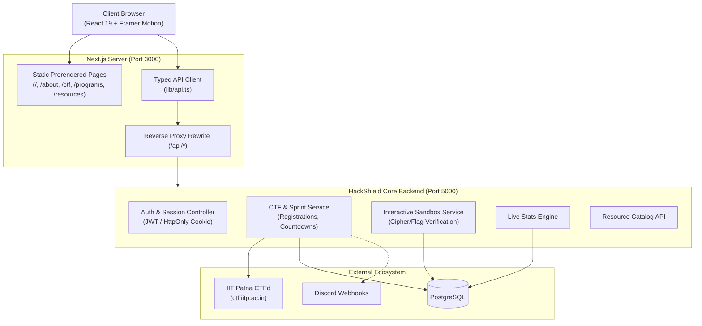

# 🛡️ HackShield — Backend Team Integration Guide (Next.js & TypeScript)

> **Audience**: Backend Engineers, CTF Platform Architects, DevOps & Systems Leads.  
> **Frontend Stack**: Next.js 15 (App Router), React 19, TypeScript 5.7, Framer Motion 12.  
> **Frontend Directory**: `hackshield-next/`

---

## 1. System Architecture & Gateway

The Next.js App Router serves as the edge presentation and client layer. To eliminate Cross-Origin Resource Sharing (CORS) complexity during development and production, the Next.js server includes a built-in reverse proxy rewrite in [`next.config.mjs`](./next.config.mjs):



---

## 2. Environment Configuration

Copy [`.env.example`](./.env.example) to `.env.local`:

```bash
cp .env.example .env.local
```

| Variable | Target | Description | Example |
| :--- | :--- | :--- | :--- |
| `BACKEND_URL` | Server-side | Destination for Next.js `/api/:path*` proxy rewrite | `http://localhost:5000` |
| `NEXT_PUBLIC_API_URL` | Client-side | Base URL for direct client requests (if not proxying) | `/api/v1` or `https://api.hackshield.iitp.ac.in/api/v1` |
| `NEXT_PUBLIC_CTFD_URL` | Client-side | Official IIT Patna CTFd instance URL | `https://ctf.iitp.ac.in` |
| `NEXT_PUBLIC_WHATSAPP_LINK`| Client-side | Community invite link | `https://chat.whatsapp.com/Kk4EPaNeHkp8oNQZ8O0ZR7` |

---

## 3. Standard API Envelope

All backend endpoints must adhere to this standardized JSON structure:

```typescript
export interface ApiResponse<T> {
  success: boolean
  data?: T
  error?: {
    code: string        // e.g. "VALIDATION_ERROR", "ALREADY_REGISTERED", "INVALID_FLAG"
    message: string     // Human-readable message displayed to user
    details?: unknown   // Optional field-level validation errors
  }
  timestamp: string     // ISO 8601
}
```

---

## 4. Endpoints & Data Contracts

### 4.1 Mini CTF 3D Flip Card Registration
* **Frontend Component**: [`app/ctf/page.tsx`](./app/ctf/page.tsx)
* **Trigger**: Participant clicks "Join Sprint", flips the card, fills Institute Email & pwn.college username, and submits.

#### `POST /api/v1/ctf/mini-sprints/:sprintId/register`

**Request Body**:
```json
{
  "email": "student.cs23@iitp.ac.in",
  "pwnUsername": "0x_pwnmaster"
}
```

**Success Response (`201 Created`)**:
```json
{
  "success": true,
  "data": {
    "registrationId": "reg_sprint14_89123",
    "sprintId": "mini-14",
    "email": "student.cs23@iitp.ac.in",
    "pwnUsername": "0x_pwnmaster",
    "status": "CONFIRMED",
    "arenaUrl": "https://ctf.iitp.ac.in/arenas/mini-14",
    "registeredAt": "2026-11-07T02:40:00.000Z"
  },
  "timestamp": "2026-11-07T02:40:00.000Z"
}
```

**Validation Error Response (`422 Unprocessable Entity`)**:
```json
{
  "success": false,
  "error": {
    "code": "INVALID_INSTITUTE_EMAIL",
    "message": "Registration is strictly restricted to valid IIT Patna institute email addresses (@iitp.ac.in).",
    "details": [{ "field": "email", "issue": "Domain must end in @iitp.ac.in" }]
  },
  "timestamp": "2026-11-07T02:40:00.000Z"
}
```

---

### 4.2 Mini CTF Sprints List
* **Frontend Component**: [`app/ctf/page.tsx`](./app/ctf/page.tsx)
* **Trigger**: On page mount, displays active, scheduled, and vault sprints.

#### `GET /api/v1/ctf/mini-sprints`

**Success Response (`200 OK`)**:
```json
{
  "success": true,
  "data": [
    {
      "id": "mini-14",
      "title": "Mini CTF #14: OAuth & Web Infiltration",
      "status": "REGISTRATION OPEN",
      "statusColor": "#10b981",
      "date": "Next Saturday · 6:00 PM – 9:00 PM IST",
      "duration": "3 Hours",
      "challenges": "6 Targeted Boxes",
      "difficulty": "Intermediate",
      "format": "Solo or Duos",
      "reward": "500 Club XP + 'Web Infiltrator' Digital Badge",
      "description": "Fast-paced sprint targeting modern OAuth redirect leaks, SSRF escalation in AWS metadata, and JWT signature forgery."
    }
  ],
  "timestamp": "2026-11-07T02:40:00.000Z"
}
```

---

### 4.3 Flagship CTF 2025 Countdown & Status
* **Frontend Component**: [`app/ctf/page.tsx`](./app/ctf/page.tsx)
* **Trigger**: Syncs live server time and tournament countdown timer.

#### `GET /api/v1/ctf/flagship/status`

**Success Response (`200 OK`)**:
```json
{
  "success": true,
  "data": {
    "title": "HackShield CTF 2025",
    "status": "REGISTRATION_OPENING_SOON",
    "eventStart": "2025-03-15T09:00:00.000Z",
    "registrationOpens": "2025-02-15T00:00:00.000Z",
    "serverTime": "2026-11-07T02:40:00.000Z",
    "prizePool": "₹1,00,000+",
    "teamSize": "1–4"
  },
  "timestamp": "2026-11-07T02:40:00.000Z"
}
```

---

### 4.4 Interactive Terminal Sandbox Flag Validation
* **Frontend Component**: [`components/InteractiveTerminal.tsx`](./components/InteractiveTerminal.tsx)
* **Trigger**: User types `decrypt`, `solve`, or submits a flag in the browser sandbox.

#### `POST /api/v1/terminal/validate-flag`

**Request Body**:
```json
{
  "flag": "FLAG{H4CK_L34RN_D3F3ND_T0G3TH3R_IITP_2025}"
}
```

**Success Response (`200 OK`)**:
```json
{
  "success": true,
  "data": {
    "correct": true,
    "pointsAwarded": 100,
    "rank": 42,
    "badgeEarned": "Novice Cryptanalyst",
    "message": "[✓] SUCCESS! Welcome to the inner circle. Submit this at our next Rookie CTF!"
  },
  "timestamp": "2026-11-07T02:40:00.000Z"
}
```

---

### 4.5 Live Community Stats
* **Frontend Component**: [`components/StatsSection.tsx`](./components/StatsSection.tsx)
* **Trigger**: Displayed on home screen with count-up animation.

#### `GET /api/v1/stats/live`

**Success Response (`200 OK`)**:
```json
{
  "success": true,
  "data": [
    { "value": 100, "suffix": "+", "label": "Active Members", "sub": "Across B.Tech, M.Tech & Ph.D" },
    { "value": 15, "suffix": "+", "label": "CTF Competitions", "sub": "Organized & Participated" },
    { "value": 50, "suffix": "+", "label": "Hands-on Labs", "sub": "Offensive & Defensive Workshops" },
    { "value": 4, "suffix": "+", "label": "Years of Excellence", "sub": "Founded at IIT Patna in 2021" }
  ],
  "timestamp": "2026-11-07T02:40:00.000Z"
}
```

---

### 4.6 Programs Enrollment / Waitlist
* **Frontend Component**: [`app/programs/page.tsx`](./app/programs/page.tsx)
* **Trigger**: User clicks "Join Cohort Waiting List" on 6-Week Guided Track.

#### `POST /api/v1/programs/apply`

**Request Body**:
```json
{
  "programId": "bootcamp-6week",
  "email": "student@iitp.ac.in",
  "experienceLevel": "Beginner",
  "motivation": "Looking to specialize in binary exploitation and contribute to club CTFs."
}
```

---

### 4.7 Resources Catalog
* **Frontend Component**: [`app/resources/page.tsx`](./app/resources/page.tsx)
* **Trigger**: Instant search and tab filtering across tools, platforms, cheat sheets, and communities.

#### `GET /api/v1/resources?category=platforms&search=burp`

---

## 5. TypeScript Types Mapping

All shared data contracts are located in [`types/index.ts`](./types/index.ts). The backend team can use these interfaces directly or generate backend schemas (e.g. Pydantic, Zod, TypeBox):

```typescript
import { 
  MiniCTFSprint, 
  PastCTFEvent, 
  CTFCategory, 
  ProgramTrack, 
  ResourceItem, 
  StatItemType 
} from '@/types'
```

A fully typed client library is provided in [`lib/api.ts`](./lib/api.ts) for simple integration:
```typescript
import { api } from '@/lib/api'

// Example: Fetch all mini sprints
const { data, error } = await api.getMiniSprints()

// Example: Register for sprint
const result = await api.registerMiniSprint('mini-14', {
  email: 'user@iitp.ac.in',
  pwnUsername: '0xPwn'
})
```

---

## 6. Authentication & Session Strategy

For authenticated routes (e.g. participant profile, private scoreboard, challenge submissions):

1. **JWT in HttpOnly, Secure, SameSite=Strict Cookies**: Prevents client-side XSS flag leakage.
2. **CORS Configuration** (if running without Next.js proxy rewrite):
   ```python
   # FastAPI example
   app.add_middleware(
       CORSMiddleware,
       allow_origins=["http://localhost:3000", "https://hackshield.iitp.ac.in"],
       allow_credentials=True,
       allow_methods=["GET", "POST", "PUT", "DELETE", "OPTIONS"],
       allow_headers=["*"],
   )
   ```
3. **IIT Patna Email Verification Regex**:
   ```regex
   ^[a-zA-Z0-9._%+-]+@iitp\.ac\.in$
   ```

---

## 7. Connecting to IIT Patna CTFd Instance

```
[HackShield Backend]
        │
        ├── Bearer Token Auth ────────► [CTFd /api/v1/users]
        ├── Fetch Live Scores ────────► [CTFd /api/v1/scoreboard]
        └── Webhook Event Listener ◄─── [CTFd on_flag_captured]
```

* **CTFd API Token**: Generate a Dedicated Service Account Token in CTFd Admin Settings with read-only access to `/api/v1/scoreboard`.
* **Sync Frequency**: Cache scoreboard data for 60 seconds (in Redis or in-memory) to protect the CTFd database from load spikes during live events.

---

## 8. Docker Compose (Frontend + Backend Stack)

```yaml
version: '3.8'

services:
  # Next.js 15 Frontend
  frontend:
    build:
      context: ./hackshield-next
      dockerfile: Dockerfile
    ports:
      - "3000:3000"
    environment:
      - BACKEND_URL=http://backend:5000
      - NEXT_PUBLIC_API_URL=/api/v1
    depends_on:
      - backend

  # Core API Backend (Node.js / Python / Go)
  backend:
    build:
      context: ./backend
    ports:
      - "5000:5000"
    environment:
      - DATABASE_URL=postgres://hs_user:hs_pass@db:5432/hackshield
      - REDIS_URL=redis://redis:6379
      - CTFD_URL=https://ctf.iitp.ac.in
      - CTFD_API_TOKEN=${CTFD_API_TOKEN}
    depends_on:
      - db
      - redis

  db:
    image: postgres:16-alpine
    environment:
      POSTGRES_DB: hackshield
      POSTGRES_USER: hs_user
      POSTGRES_PASSWORD: hs_pass
    volumes:
      - pgdata:/var/lib/postgresql/data

  redis:
    image: redis:7-alpine

volumes:
  pgdata:
```

---

## 9. Contacts & Coordination

* **Lead Coordinator**: Yash Bhople (`yash_ua2504aih274@iitp.ac.in`)
* **Core Research**: Ishan Mishra (`ishanmishra079@gmail.com`)
* **Campus**: Indian Institute of Technology Patna, Bihta, Bihar 801106
* **WhatsApp Group**: [Join Community](https://chat.whatsapp.com/Kk4EPaNeHkp8oNQZ8O0ZR7)

